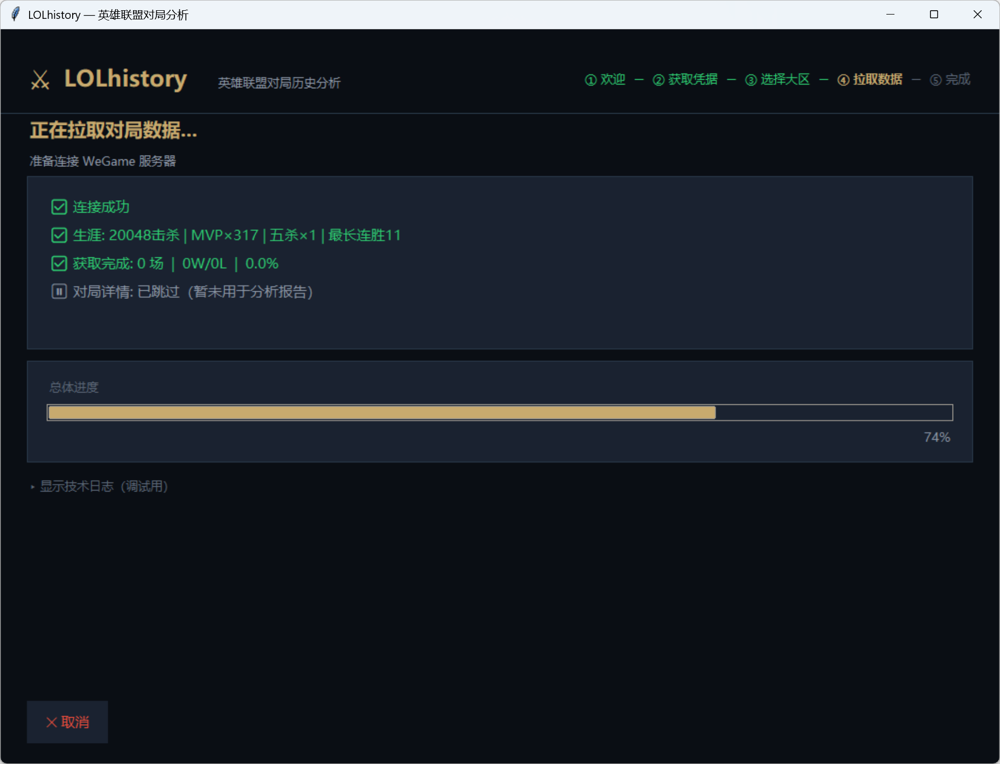
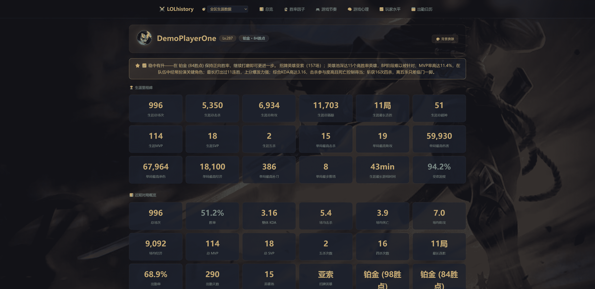

<p align="center">
  
  
  
  
  
</p>

<br>

<h1 align="center">⚔️ LOLhistory</h1>

<p align="center">
  <strong>你的每一场召唤师峡谷之战，都值得被记住。</strong>
</p>

<p align="center">
  从 WeGame 一键导出完整的英雄联盟对局历史——<br>
  段位变迁、KDA 走势、装备符文、10 人全量数据，全部落到你本地。
</p>

<br>

---

## 🤔 为什么需要这个？

League 客户端只展示最近 20 场。WeGame 助手虽然能看到更多，但数据锁在网页里——既不能导出，也没法分析。

**LOLhistory** 把你散落在腾讯服务器上的对局数据全部取回来：最多 **500 场**完整对局，含段位历史、装备符文、10 人详情。SQLite 可以跑 SQL 分析，交互式 HTML 报告打开即用。

> 客户端都不用开。有 Cookie 就能随时拉数据，更有 GUI 图形界面零门槛上手。

---

## ✨ 核心亮点

| | |
|---|---|
| 🖥️ **GUI 图形界面** | 全新 tkinter GUI，4 步向导式流程，一键完成：获取凭据 → 拉取数据 → 生成报告。无需命令行，可打包为独立 exe 分发 |
| 🍪 **一键抓包** | GUI 内一键启动代理 / CLI `--capture-cookies`，登录 WeGame 即自动获取 Cookie——告别 Fiddler/Charles 手动操作 |
| 🔌 **WeGame API** | 无需客户端，最大 500 场 + 段位历史 + 装备符文 + 10 人完整详情 |
| 📁 **智能 Cookie 提取** | 也支持从 Fiddler/Charles/浏览器 抓包文件中自动提取，兼容 HAR、Raw、cURL、Charles 四种格式 |
| 📊 **双重导出格式** | CSV（UTF-8 BOM，Excel 即开）+ SQLite（6 张表：对局摘要、10 人详情、召唤师资料、英雄熟练度、赛季历史、生涯总览） |
| 🔄 **增量合并** | 重复运行自动去重追加——只拉新对局，不覆盖旧数据 |
| 🔍 **缺失回填** | 自动检测 match_detail 中缺失的对局并补获取，历史数据不遗漏 |
| 🏆 **段位历史** | 每局 tier / league_points / rank 全记录（WeGame） |
| 🧩 **10 人完整详情** | 7 件装备、6 枚符文、召唤师技能、伤害/承伤/视野——敌我双方全量 |
| 🚫 **智能过滤** | 默认跳过云顶之弈对局，只保留召唤师峡谷 |
| 🗺️ **完整识别** | 96 种游戏队列 × 17 张地图，从排位到极限闪击全覆盖 |
| 📊 **交互式分析报告** | 6 大板块 30+ 图表——胜率因子、英雄雷达、段位趋势、出勤热力图… |
| 🌐 **全大区支持** | 全部 29 个大区，支持中文名/逗号分隔/全区三种模式，自动跳过无账号大区 |
| 📊 **跨区分析报告** | 多区数据合并分析，HTML 报告内置区域切换器，一键对比各区表现 |
| 🔐 **纯本地运行** | 数据直达你的硬盘，不经过任何第三方 |

---

## 📦 快速开始

### 方式一：GUI 图形界面（推荐，零门槛）

GUI 把所有操作整合为 **4 步向导**，无需记忆任何命令：

```
① 欢迎页  →  ② 获取凭据  →  ③ 拉取数据  →  ④ 完成 & 打开报告
```

**启动方式：**

```bash
# 源码运行
pythonw gui_app.py
```

或使用打包好的 `LOLhistory.exe`（见 [Releases](https://github.com)），双击直接运行，无需安装 Python。



**首次使用流程：**

1. 启动 GUI，深色 League 主题界面跃然屏上
2. 点击「开始使用」→ 进入凭据获取页
3. 界面自动检测 HTTPS 证书状态——未安装则一键点击安装（仅需一次，无需管理员）
4. 点击「一键抓包」→ 登录 WeGame → 凭据自动捕获并保存
5. 点击「连接并拉取数据」→ 实时查看进度：连接 → 召唤师信息 → 对局列表 → 详情 → 导出 → 报告
6. 完成后点击「📊 在浏览器中打开分析报告」

> **Cookie 自动持久化**：凭据保存在 `%APPDATA%/lolhistory/cookies.json`，下次启动自动加载，无需重复抓取。

**GUI 界面亮点：**

- 深色 Shadow Isles 主题，与 HTML 分析报告视觉风格统一
- 抓包实时日志 + 数据拉取分阶段进度条
- 一键抓包自动获取凭据，无需手动操作
- 可折叠技术日志区，普通用户无需关心
- 数据拉取可随时取消



---

### 方式二：命令行

#### 前置条件

- **Python 3.10+**
- WeGame 账号

#### 1. 安装

```bash
git clone https://github.com/<your-username>/<repo-name>.git
cd <repo-name>

python -m venv .venv
.venv\Scripts\activate
pip install -r requirements.txt   # requests + mitmproxy
```

#### 2. 获取 Cookie

**🆕 一键抓包（推荐，无需任何手动操作）**

```bash
# 首次使用：安装 mitmproxy 根证书（仅需一次，无需管理员）
python -m lolhistory --install-cert

# 一键抓包：代理自动启动 → 登录 WeGame → Cookie 自动保存
python -m lolhistory --capture-cookies
```

登录 WeGame 即自动完成！Cookie 保存为 `cookies.json`，随后直接使用。

> **原理**：内嵌 mitmproxy HTTP 代理 + Windows 系统代理，自动拦截 WeGame 登录时的认证请求。无需打开助手页/对局记录页，无需任何抓包工具。

<details>
<summary><strong>备选方案：从抓包文件提取（点此展开）</strong></summary>

打开 WeGame → 点击「WeGame 助手」→ 对局记录页面。用抓包工具导出 **任意一个** `www.wegame.com.cn` 的 HTTPS 请求：

| 工具 | 操作 |
|---|---|
| **Fiddler** | 右键请求 → Save → Request → Raw，放入 `wegame-api-export/` |
| **Charles** | 右键请求 → Export → HAR，放入 `wegame-api-export/` |
| **浏览器 DevTools** | Network → 右键请求 → Copy as cURL → 粘贴到 `.txt` 文件 |

然后提取：

```bash
python -m lolhistory --extract-cookies
```

</details>

输出示例：

```json
{
  "puin": "xxxxxxxxxx",
  "pkey": "0003...",
  "tgp_biz_ticket": "0100...",
  "tgp_id": "xxxxxxxx"
}
```

> 💡 **Cookie 有效期**：与 WeGame 助手页共享 session，通常管几小时到一天。过期后重新运行 `--capture-cookies` 即可。

#### 3. 拉数据！

```bash
# 基础用法——拉取对局列表（含段位数据 + 自动获取召唤师/英雄/生涯/赛季信息）
python -m lolhistory --cookies cookies.json

# 全部拉满——500 场 + 每场 10 人完整装备符文详情
python -m lolhistory --cookies cookies.json -n 500 --detail

# 只看某一场的完整数据
python -m lolhistory --cookies cookies.json --detail-game GAME_ID

# 指定大区（默认艾欧尼亚=1）
python -m lolhistory --cookies cookies.json --area 4

# 多区拉取——大区中文名（逗号分隔）
python -m lolhistory --cookies cookies.json --area 艾欧尼亚,祖安,黑色玫瑰

# 全部大区——自动跳过无账号大区
python -m lolhistory --cookies cookies.json --area all
```

跑完在 `output/` 目录生成两个文件：

```
output/wegame_matches.csv    ← Excel 拖进去就能看，36 列中文表头
output/wegame_matches.db     ← SQLite，6 张表（对局摘要 + 10 人详情 + 召唤师资料 + 英雄熟练度 + 赛季历史 + 生涯总览）
```

> 💡 想放到别处用 `-o` 指定，例如 `-o ./my-data`。

---

## 🧭 命令行参考

### WeGame API 参数

| 参数 | 说明 |
|---|---|
| `--cookies cookies.json` | Cookie 文件路径 |
| `--area AREA` | 大区：支持 ID（`1`）、中文名（`艾欧尼亚`）、逗号分隔（`艾欧尼亚,祖安`）、`all`/`全部`（29 区）。默认 `1` |
| `-n N` | 最大对局数（默认 501，上限 ~500） |
| `--detail` | 逐场拉取 10 人完整详情（装备/符文/ban） |
| `--detail-game ID` | 查单场详情并在终端打印 |
| `-o DIR` | 输出目录（默认 `output/`） |
| `--no-csv` | 跳过 CSV 导出（仅导出 SQLite） |
| `--no-sqlite` | 跳过 SQLite 导出（仅导出 CSV） |
| `--openid BASE64` | 手动指定加密 openid（省略则自动探测） |
| `-v` / `--verbose` | 详细调试日志 |

Cookie 还可以直接从命令行传入（无需文件）：

```bash
python -m lolhistory --puin <puin> --pkey "<pkey>" --tgp-biz-ticket "<ticket>" --tgp-id <id>
```

### 运行时自动获取

除对局列表外，以下数据在运行时 **自动获取**（无需额外参数）：

- **召唤师信息** — 等级 / 当前段位 / 赛季胜率
- **英雄熟练度** — 172 英雄的场次、胜率、常用分路
- **赛季报告** — 全模式总览统计 + 26 赛季段位历史
- **生涯统计** — 生涯总击杀 / MVP / 五杀 / 最长连胜

自动写入 SQLite 对应表中，获取失败仅 warning 不阻断导出。

---

## 📋 导出数据说明

### match_summary（每场对局一行，36 列）

```
对局ID    日期      时间      游戏时长    队列类型    地图    英雄ID    位置
击杀      死亡      助攻      KDA        评分       金币    双杀~五杀
MVP / SVP / 投降 / 挂机   击杀最多 / 助攻最多 / 金币最多 / 伤害最高 / 承伤最高 / 推塔最多
段位      胜点      段位等级    游戏版本    大区
```

### match_detail（每局每位玩家一行，33 列）

```
对局ID    召唤师名称    英雄ID    阵营    胜负    KDA
装备×7    召唤师技能×2    符文×6
伤害      承伤      金币    补刀    视野分    控制分    is_self（标记哪行是你）
```

---

## 📊 数据分析报告

命令行一行生成，GUI 自动生成。浏览器打开即可看到交互式 HTML 报告：

```bash
python -m lolhistory --analyze
```

### 先看效果：脱敏示例报告

不想装 Python，也想先看成品长什么样？直接打开仓库里这份示例报告：

**[`demo/demo_report.html`](demo/demo_report.html)** — 996 局、3 个大区的虚构数据（玩家名统一为 `DemoPlayer*`，无真实信息）。

数据由 `demo/demo_generate_data.py` 生成，可随时重新生成（数据库为可再生文件，不入库）：

```bash
.venv/Scripts/python demo/demo_generate_data.py
```

### 6 大分析板块，30+ 图表

| 板块 | 分析内容 |
|---|---|
| 🏠 **总览** | 17 张统计卡片：胜率、KDA、场均经济、MVP/SVP 率、五杀/四杀、出勤率、英雄池、招牌英雄、最高 & 当前段位… |
| 🔮 **胜率因子** | 星期几胜率最高？哪个时段最强？红蓝方差距？打什么位置最稳？KDA 区间 × 胜率？游戏时长影响？——胜率极差排名，找出你的"胜利密码" |
| 🎮 **游戏节奏** | 连续游戏 Session 规模分布、首局开始时间、末局结束时间、轮次内第 N 局胜率、「再来一局」陷阱、输后 vs 赢后胜率 |
| 🧠 **游戏心理** | 连胜/连败分布、发挥稳定性、挂机影响、投降分析、过度自信与救赎效应 |
| 📈 **玩家水平** | 英雄池分布、招牌英雄雷达图（KDA/击杀/生存/经济效率）、多杀含金量、Carry 依赖度画像、经济效率分析 |
| 📅 **出勤日历** | GitHub 风格热力图、10 场滚动胜率、时段热力分布、段位 LP 趋势、每日 LP 变化 |

### 多区分析

支持多区数据合并分析。当数据库包含多个大区数据时，报告自动：

- 生成 **全区合并分析**，按区域切换器下拉菜单切换查看各区数据
- 英雄皮肤背景随大区切换自动刷新
- 报告文件名格式：`report_艾欧尼亚等3区_2026-06-13.html`

> 💡 采集多区数据只需在拉取时加上 `--area 艾欧尼亚,祖安,黑色玫瑰` 或 `--area all`。

### 图表特点

- **暗色 League 主题**：Shadow Isles 风格，金色/蓝色点缀
- **纯静态 HTML**：无需服务器，浏览器打开即用
- **每张图表配有中文概要**：金色斜体一句话总结，直击要点
- **响应式布局**：手机/平板/桌面全适配

### 自定义参数

```bash
python -m lolhistory --analyze --db my_matches.db          # 指定数据库
python -m lolhistory --analyze --output my_report.html      # 指定输出路径
```

> 默认读取 `output/wegame_matches.db`，该文件不存在时自动回退到当前目录的 `wegame_matches.db`；报告默认写到 `output/report_<日期>.html`。

> 💡 **数据要求**：基础分析只需 `match_summary` 表；装备/符文等详情维度需要 `--detail` 导出的 `match_detail` 表。

---

## 🔧 常见问题

<details>
<summary><strong>Cookie 过期了（错误码 8025009）怎么办？</strong></summary>
重新运行一键抓包（GUI 点击按钮 / CLI <code>--capture-cookies</code>），覆盖凭据即可。已经导出的数据不会丢失——增量机制会自动跳过已有对局。
</details>

<details>
<summary><strong>为什么只能拉到 ~500 场？</strong></summary>
WeGame API 服务端限制，<code>offset ≥ 500</code> 直接返回空。这是腾讯后端的数据保留策略，国服目前没有已知方式突破。
</details>

<details>
<summary><strong>重复运行会覆盖数据吗？</strong></summary>
不会。SQLite 按 <code>对局ID</code> 去重，重复运行只追加新对局，不覆盖旧数据。还会自动检测并回填历史上缺失的详情数据。
</details>

<details>
<summary><strong>GUI 和命令行数据互通吗？</strong></summary>
互通。两者使用同一套数据库结构（<code>wegame_matches.db</code>）：GUI 输出在程序所在目录，命令行默认输出到 <code>output/</code>。省略 <code>--db</code> 时，命令行会自动回退读取当前目录的 <code>wegame_matches.db</code>；需要指定其他位置时加 <code>--db 路径</code> 即可。
</details>

<details>
<summary><strong>分析报告能分析哪些数据？</strong></summary>
分析报告从 SQLite 读取数据，涵盖 <strong>6 大板块 30+ 维度</strong>：胜率因子（星期/时段/位置/红蓝方/KDA/时长）、英雄雷达图、段位趋势、出勤日历、Session 模式、心理风格（连胜/连败/发挥稳定性）、经济效率等。报告为纯静态 HTML，浏览器打开即用。
</details>

<details>
<summary><strong>如何打包为独立 exe？</strong></summary>

```bash
python gui_app_build_exe.py
```

生成 `dist/LOLhistory.exe`（约 27MB），可复制到任意 Windows 电脑直接运行，无需安装 Python 或任何依赖。首次使用在 GUI 内点击「安装 HTTPS 证书」即可。
</details>

---

## 📜 License

[MIT](LICENSE) © 2026

---

<p align="center">
  <sub>Made with ❤️ for the Summoner's Rift community. GGWP!</sub>
</p>
